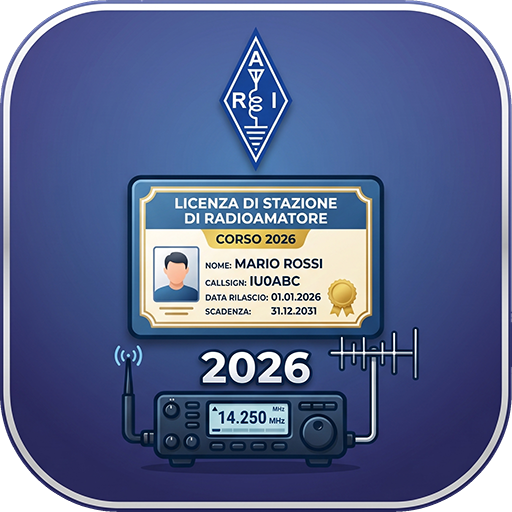

# Corso Base di Elettronica e Radiotecnica — ARIGO 2026

Dispensa del corso per la preparazione all'esame da radioamatore (ARIGO 2026).

- Pagina: `index.html`
- Versione attuale: **1.9.0** (versionamento semantico `MAJOR.MINOR.PATCH`)

Le immagini dei diagrammi (JPG) sono in `assets/images/` e sono versionate insieme alla pagina.
